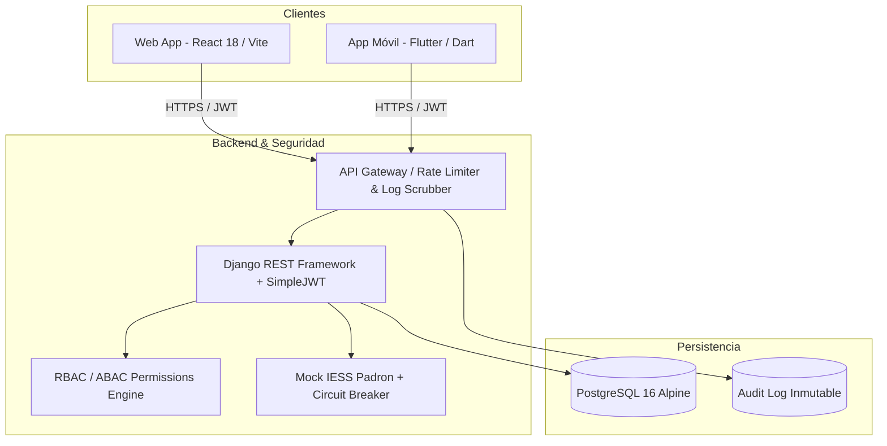

# Sistema Seguro de Gestión de Turnos Médicos - IESS

Sistema integral y seguro para la gestión de turnos médicos del Instituto Ecuatoriano de Seguridad Social (IESS), diseñado bajo el principio de **Defensa en Profundidad**, cumplimiento estricto de la **Ley Orgánica de Protección de Datos Personales (LOPDP)** del Ecuador, mitigación de vulnerabilidades del **OWASP Top 10** (incluyendo Anti-BOLA/IDOR, Anti-Fuerza Bruta y Anti-SQLi) y arquitectura modular de 3 capas con clientes Web y Móvil.

---

## 🏛️ Arquitectura del Sistema



- **Base de Datos**: PostgreSQL 16 Alpine sobre contenedor Docker con esquemas mínimos (LOPDP).
- **Backend**: Python 3.12 + Django REST Framework con autenticación JWT, control de acceso RBAC/ABAC y middleware sanitizador.
- **Frontend Web**: React 18 con Vite y Axios (vistas especializadas por rol: Afiliado, Recepción, Médico, Soporte, Administrador).
- **App Móvil**: Flutter / Dart orientada exclusivamente a los afiliados (agendamiento, delegación familiar, avisos y registro biométrico/cédula).
- **Seguridad Automatizada**: Suite de pruebas ejecutables (`verify_security.py`) que valida el 100% de los controles.

---

## 📁 Estructura del Repositorio

```text
├── docker-compose.yml       # Orquestación de BD PostgreSQL y Backend
├── README.md                # Documentación técnica completa
├── .gitignore               # Exclusión de binarios, dependencias y cachés
├── db/
│   └── init.sql             # Esquema inicial y datos semilla de prueba
├── backend/
│   ├── Dockerfile           # Imagen Docker del servicio Django
│   ├── requirements.txt     # Dependencias Python
│   ├── manage.py
│   ├── config/              # settings.py, urls.py, wsgi.py
│   └── core/                # Módulo central de la aplicación
│       ├── models.py        # Modelos de datos mínimos (User, Turno, Delegacion, AuditLog)
│       ├── serializers.py   # Validaciones de Cédula Ecuatoriana (Módulo 10) y contraseñas
│       ├── views.py         # Endpoints REST protegidos
│       ├── permissions.py   # RBAC estricto y ABAC (Anti-BOLA/IDOR)
│       ├── middleware.py    # Sanitizador de logs (Log Scrubber) y Rate Limiting
│       └── services.py      # Mock API Padrón IESS + Circuit Breaker (pybreaker)
├── frontend/
│   ├── package.json
│   ├── vite.config.js
│   └── src/
│       ├── api/client.js    # Cliente Axios con interceptor JWT y refresco automático
│       ├── pages/
│       │   ├── Login.jsx    # Autenticación con MFA OTP y cambio forzoso de clave
│       │   ├── DashboardAfiliado.jsx    # Gestión de turnos, delegaciones y familiares
│       │   ├── DashboardFuncionario.jsx # Vistas restringidas (Recepción, Médico, Soporte, Admin)
│       │   └── TurnoDetalle.jsx         # Enlace seguro a citas (requiere sesión)
│       └── App.jsx          # Enrutador protegido por AuthGuard
├── app_movil/
│   └── examen_iess/         # Aplicación Móvil en Flutter para Afiliados
│       ├── pubspec.yaml
│       └── lib/
│           ├── main.dart
│           ├── models/models.dart           # DTOs tipados (User, Turno, Delegacion)
│           ├── services/
│           │   ├── api_service.dart         # Cliente HTTP con JWT y control de rol Afiliado
│           │   └── security_utils.dart      # Validador de Cédula Módulo 10 y Claves
│           └── screens/
│               ├── login_screen.dart        # Login con MFA y cambio de host
│               ├── registro_afiliado_screen.dart # Registro LOPDP en 3 pasos con OTP
│               └── dashboard_afiliado_screen.dart # Agendamiento, delegaciones y avisos
└── security_tests/
    └── verify_security.py   # Suite automatizada de pruebas de seguridad (8/8 controles)
```

---

## 🔒 Matriz de Cumplimiento de Requerimientos de Seguridad

| Requisito | Control Implementado | Estado |
|---|---|---|
| **ID 101 - Funciones** | Bloqueo atómico con `select_for_update()`, constraint `UNIQUE(medico_id, fecha, hora)`, límite de 1 turno activo por especialidad y cancelación/reprogramación con anticipación mínima de 24 horas. | ✅ Cumplido |
| **ID 102 - Identificación** | Validación de Cédula Ecuatoriana (Algoritmo Módulo 10 del Registro Civil), contraste con Padrón IESS, recolección mínima de datos (solo email y teléfono) y activación con OTP de 6 dígitos. | ✅ Cumplido |
| **ID 106 - Familiares (Anti-BOLA)** | Prohibición de agendamiento directo por cédula de terceros. Validación automática de hijos menores y verificación por código OTP para autorizar adultos delegados. | ✅ Cumplido |
| **ID 107 - Autenticación Robusta** | Prohibido usar cédula o fecha de nacimiento como clave. Mínimo 12 caracteres con complejidad (mayúsculas, minúsculas, números y símbolos). Bloqueo tras 5 intentos fallidos por 15 minutos y segundo factor MFA (OTP). | ✅ Cumplido |
| **ID 108 - Permisos (RBAC/ABAC)** | Recepción solo ve turnos de hoy en su unidad con datos de contacto enmascarados; Médicos solo acceden a su agenda; Soporte técnico únicamente consulta métricas y logs sanitizados; Administradores gestionan catálogos. | ✅ Cumplido |
| **ID 109 - Notificaciones Seguras** | Notificaciones sin enlaces directos sin autenticación ni diagnósticos clínicos. Solo redirigen a iniciar sesión. | ✅ Cumplido |
| **ID 110 - Integración y Resiliencia** | Circuit Breaker configurado con límite de fallos y recuperación automática; caché de 15 minutos para consultas de afiliación. | ✅ Cumplido |
| **ID 111 - Auditoría Inmutable** | `AuditLogMiddleware` reemplaza automáticamente contraseñas, tokens JWT y códigos OTP por `[REDACTED]` antes de almacenar en base de datos. | ✅ Cumplido |
| **ID 114 - Minimización LOPDP** | Esquema de base de datos sin campos sensibles ni clínicos (prohibido empleador, sueldo, diagnósticos, recetas o religión). | ✅ Cumplido |
| **Protección Anti-SQLi** | Consultas 100% parametrizadas mediante el ORM de Django y uso exclusivo de queries preparadas con tipado estricto en serializers. | ✅ Cumplido |

---

## 👥 Cuentas de Prueba Preconfiguradas

Todas las contraseñas iniciales cumplen con la política de seguridad (mínimo 12 caracteres, alfanumérico y símbolos).

| Rol | Cédula | Contraseña Inicial | Características / Permisos |
|---|---|---|---|
| **Afiliado (Titular)** | `1710000017` | `ClaveSegura#IESS2026!` | Acceso a Web y App Móvil. Turnos propios, delegación familiar y notificaciones. |
| **Afiliado (Con cambio obligatorio)** | `1720000028` | `ClaveTemporal#2026!` | Obliga a cambiar contraseña en primer inicio de sesión antes de operar. |
| **Recepción** | `1730000039` | `ClaveSegura#IESS2026!` | Exclusivo Web. Vista de turnos del día de su hospital con teléfonos/correos enmascarados. |
| **Médico** | `1740000040` | `ClaveSegura#IESS2026!` | Exclusivo Web. Visualización de turnos asignados a su agenda y confirmación de atención. |
| **Soporte TI** | `1750000051` | `ClaveSegura#IESS2026!` | Exclusivo Web. Auditoría sanitizada (`[REDACTED]`) y estado de servicios técnicos. |
| **Administrador** | `1760000062` | `ClaveSegura#IESS2026!` | Exclusivo Web. Catálogos institucionales y métricas del sistema. |

> **Nota para entorno de pruebas**: Los códigos OTP de 6 dígitos se devuelven en el campo `debug_otp` de la respuesta o se muestran en el banner informativo de la interfaz para facilitar la evaluación sin necesidad de pasarela SMS externa.

---

## 🚀 Guía de Despliegue y Ejecución

### Requisitos Previos
- [Docker](https://www.docker.com/) y Docker Compose
- [Node.js 18+](https://nodejs.org/) (para frontend web)
- [Python 3.12+](https://www.python.org/)
- [Flutter SDK 3.x](https://flutter.dev/) (para compilar la aplicación móvil)

---

### 1. Levantar Servicios con Docker (Base de Datos + Backend)

En la raíz del proyecto:
```bash
docker compose up --build -d
```

Verificar que los contenedores estén saludables:
```bash
docker ps
```
- **PostgreSQL**: `localhost:5432`
- **Backend Django REST**: `http://localhost:8000`

---

### 2. Ejecutar la Suite de Pruebas de Seguridad Automatizada

La suite valida de forma autónoma el cumplimiento de los 8 requerimientos principales:
```bash
python security_tests/verify_security.py
```
**Resultado esperado:**
```text
======================================================================
           SUITE DE VERIFICACIÓN DE SEGURIDAD - IESS 2026             
======================================================================
[TEST 1] Autenticación Robusta y Política de Contraseñas... [PASS]
[TEST 2] Bloqueo Anti-Fuerza Bruta tras 5 Intentos...       [PASS]
[TEST 3] Cambio Obligatorio de Contraseña Temporal...       [PASS]
[TEST 4] Control de Acceso Anti-BOLA / IDOR en Turnos...    [PASS]
[TEST 5] RBAC de Recepción (Datos Enmascarados)...          [PASS]
[TEST 6] Sanitizador de Auditoría (Log Scrubber)...         [PASS]
[TEST 7] Prevención de Doble Reserva Concurrente...         [PASS]
[TEST 8] Restricción de 24h para Cancelación...             [PASS]
----------------------------------------------------------------------
RESULTADO: 8/8 PRUEBAS SUPERADAS (100% CUMPLIMIENTO)
```

---

### 3. Levantar la Aplicación Web (Frontend React)

```bash
cd frontend
npm install
npm run dev
```
Acceder en el navegador a: **`http://localhost:5173`**

---

### 4. Levantar la Aplicación Móvil (Flutter)

```bash
cd app_movil/examen_iess
flutter pub get
```

- **En Emulador Android**:
  ```bash
  flutter run
  ```
  *(Por defecto utiliza `http://10.0.2.2:8000/api` para comunicarse con el backend local).*
- **En Windows Desktop**:
  ```bash
  flutter run -d windows
  ```
  *(Tocar el chip de URL en el login y seleccionar `http://localhost:8000/api`).*

---

## 🛡️ Detalles de Seguridad Técnicos

### Validación de Cédula Ecuatoriana (Módulo 10)
Implementado tanto en backend ([`serializers.py`](backend/core/serializers.py)) como en frontend ([`Login.jsx`](frontend/src/pages/Login.jsx)) y móvil ([`security_utils.dart`](app_movil/examen_iess/lib/services/security_utils.dart)):
1. Longitud exacta de 10 dígitos numéricos.
2. Código de provincia válido (01 a 24, o 30).
3. Tercer dígito menor a 6 (personas naturales).
4. Coeficientes alternados `[2, 1, 2, 1, 2, 1, 2, 1, 2]`; productos mayores o iguales a 10 restan 9.
5. Verificador = `(10 - (suma % 10)) % 10` igual al décimo dígito.

### Protección Anti-Inyección SQL (Anti-SQLi)
- Ninguna vista utiliza concatenación directa de cadenas ni consultas sin parametrizar (`raw()` o `cursor.execute(f"...")`).
- Todas las operaciones utilizan el ORM de Django con consultas parametrizadas en controladores nativos de PostgreSQL.
- Los tipos de datos se filtran y validan estrictamente mediante serializers antes de llegar a la capa de persistencia.

---

## 📄 Licencia y Uso Académico
Proyecto desarrollado para la cátedra de **Seguridad de Software** - Universidad de las Fuerzas Armadas ESPE. Cumple con los estándares de seguridad defensiva, minimización de datos LOPDP y desarrollo seguro.
